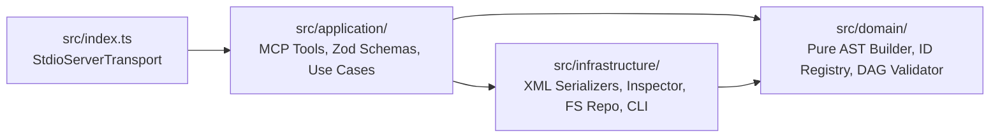

# Architecture

`seamly2d-mcp` follows **Clean Architecture** with strict unidirectional dependencies so the geometric AST builder and DAG validator remain 100% pure, deterministic, and testable without touching the filesystem or spawning processes.

## Layer Overview

### 1. Domain Layer (`src/domain/`)
- **Zero external I/O**: No `node:fs`, `node:child_process`, `node:path`, or third-party runtime imports.
- **`types.ts`**: Discriminated union AST models (`PointNode`, `LineNode`, `SplineNode`, `ArcNode`, `DetailPiece`, `ResolvedPatternAst`, `MeasurementsDocument`).
- **`id-registry.ts`**: Allocates strictly sequential, globally unique integer IDs (`1, 2, 3, ...`) and resolves symbolic names with kind validation and chronological lookup.
- **`pattern-ast-builder.ts`**: Validates chronological DAG ordering (detecting `UNDECLARED_SYMBOL`, `FORWARD_REFERENCE`, `SELF_REFERENCE`, `DUPLICATE_SYMBOL`, `INVALID_SYMBOL_KIND`), validates `#` custom variables, and projects `<modeling>` proxies and `<pieces>` contour nodes.
- **`errors.ts`**: Typed `DomainValidationError` with machine-readable error codes and structured context.

### 2. Infrastructure Layer (`src/infrastructure/`)
- **`xml/sm2d-serializer.ts`**: Deterministic serializer conforming to Seamly2D `pattern/v0.7.0.xsd` (`<pattern>`, `<variables>`, `<draftBlock>`, `<calculation>`, `<modeling>`, `<pieces>`).
- **`xml/smme-serializer.ts`**: Deterministic serializer conforming to Seamly2D `individual_size_measurements/v0.3.4.xsd` (`<smis>` with `<personal>` and `<body-measurements>`).
- **`xml/pattern-inspector.ts`**: Parses `.sm2d` (`v0.7.0` and legacy `v0.6.x`) and `.smme` (`<smis>` and legacy `<vit>`) files via `fast-xml-parser` and resolves numeric `idObject` references back to symbolic names.
- **`fs/workspace-repository.ts`**: Scopes all reads/writes strictly inside `SEAMLY_WORKSPACE` and blocks path traversal (`..`).
- **`cli/seamly2d-cli.ts`**: Injectable `execFile` wrapper around the Seamly2D headless CLI (`-b <basename> -d <destination> -f <0|1|2> -m <measurements> <pattern>`), classifying failures into `BINARY_NOT_FOUND`, `FORMULA_ERROR`, `XML_PARSE_ERROR`, and `CLI_EXECUTION_ERROR`.

### 3. Application Layer (`src/application/`)
- **`schemas.ts`**: Exhaustive Zod v4 schemas embedding `qMuParser` syntax documentation for LLM tool callers.
- **`use-cases/`**: Four stateless use cases (`manage-measurements`, `build-parametric-pattern`, `inspect-pattern`, `compile-and-export-pattern`).
- **`error-mapper.ts`**: Converts domain, workspace, XML, CLI, and Zod errors into structured `{ ok: false, errorType, code, message, details }` MCP tool results.
- **`mcp-server.ts`**: Wires all 4 tools onto `@modelcontextprotocol/sdk`'s `McpServer` (reused by both `StdioServerTransport` in production and `InMemoryTransport` in tests).

### 4. Composition Root (`src/index.ts`)
- Binds `createSeamlyMcpServer()` to `StdioServerTransport`. Never writes to `stdout` outside JSON-RPC; fatal startup errors go to `stderr`.
